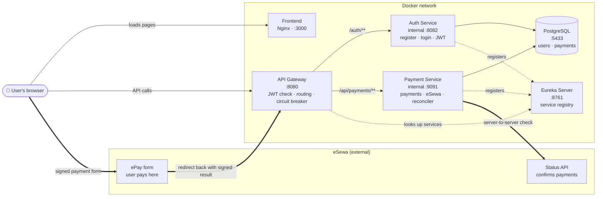
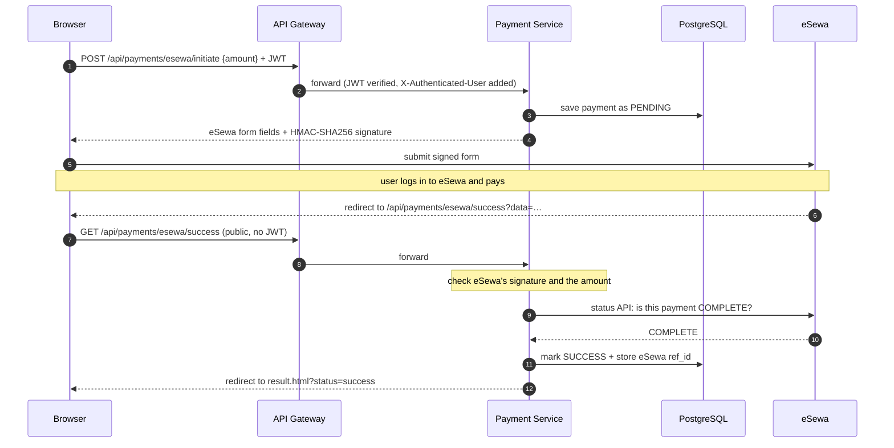

# Ripple PayGate

Ripple PayGate is a microservices-based payment gateway built with Java Spring Boot.
Users register, log in, and pay with **eSewa** (using eSewa's sandbox, so no real money moves).
It covers authentication, service discovery, fault tolerance, payment verification and a
frontend interface, all running inside Docker containers.

> **New to the project?** Read the full guide: [`docs/PROJECT_GUIDE.md`](docs/PROJECT_GUIDE.md).
> It explains every service, the payment flow step by step, how to run and test it, and troubleshooting.

---

## What It Does

A user opens the frontend, registers or logs in, enters an amount and clicks **Pay with eSewa**.
The request goes through the API Gateway, which checks the user's login token, to the Payment
Service. The Payment Service records a `PENDING` payment and returns a signed form. The browser
sends that form to eSewa, where the user pays.

eSewa then sends the user back. The Payment Service does not trust that redirect on its own: it
checks eSewa's signature and the amount, and then asks eSewa's status API directly before marking
the payment `SUCCESS` or `FAILED`. The user lands on a result page, and the payment appears under
**My recent payments**.

If the Payment Service fails or slows down, the Circuit Breaker returns a clean error message
instead of leaving the user waiting. If a payment gets stuck in `PENDING` (for example, the user
closed eSewa's page), a background job re-checks it with eSewa.

---

## Architecture



- The browser only talks to the **frontend** and the **gateway**. Auth Service and Payment Service have no
  published ports, so the gateway's login check can't be bypassed.
- Services find each other through **Eureka** by name, not by hard-coded addresses.
- **eSewa is outside our system.** The user pays on eSewa's own page. Payment Service then confirms the
  result with eSewa's status API, server to server.

### Payment flow with eSewa



If eSewa can't confirm yet, the payment stays `PENDING` (never `FAILED`, so a user who paid isn't
told to pay again). The background reconciler re-checks it every 5 minutes.

---

## Services

### Eureka Server (Port 8761)
The service registry. Every microservice registers itself here when it starts up.
The API Gateway uses Eureka to discover where to send requests, with no hard-coded URLs
between services.

### API Gateway (Port 8080)
The single entry point for all requests. No request reaches any other service
without going through here first. It does three things:
- **JWT validation**: checks that every payment request carries a valid login token, then tells the
  services behind it who the user is (and removes any such header sent by the client itself)
- **Routing**: forwards `/auth/**` to Auth Service and `/api/payments/**` to Payment Service
- **Circuit breaker**: monitors Payment Service and returns a fallback response if it fails or slows down

### Auth Service (internal port 8082)
Handles user registration and login. When a user logs in successfully, it issues a JWT,
a signed credential the user must send with every payment request.
Passwords are never stored in plain text; they are hashed with BCrypt before saving.
Invalid input and failed logins get clear JSON errors (400 / 401 / 409).
Not published outside Docker, so it's only reachable through the gateway.

### Payment Service (internal port 9091)
Takes payments through eSewa: creates a `PENDING` payment for the logged-in user, signs the eSewa form,
verifies eSewa's answer (signature + server-to-server status check) and marks the payment `SUCCESS`
or `FAILED`. A background job re-checks payments stuck in `PENDING`. Money is stored as exact decimals.
Not published outside Docker, so it's only reachable through the API Gateway.

### PostgreSQL Database (Port 5433)
Stores all application data in two tables, created by Flyway migrations:
- `users`: registered accounts (managed by Auth Service)
- `payments`: payments and who made them (managed by Payment Service)

### Frontend (Port 3000)
A simple web interface served by Nginx. Users can register, log in, pay with eSewa and see their
recent payments without needing Postman or any technical tools.

---

## Tech Stack

| Technology | Purpose |
|---|---|
| Java 21 | Programming language |
| Spring Boot 4 / Spring Cloud 2025.1 | Application framework |
| Spring Cloud Gateway | Reactive API Gateway |
| Netflix Eureka | Service discovery |
| Spring Security + JWT | Authentication |
| Resilience4j | Circuit Breaker |
| eSewa ePay v2 (sandbox) | Payment provider |
| Spring Data JPA | Database access |
| Flyway | Database schema migrations |
| PostgreSQL | Persistent storage |
| Docker + Docker Compose | Containerization |
| Nginx | Frontend static file server |

---

## How to Run

### Prerequisites
- Docker Desktop installed and running
- Git

### Steps

1. Clone the repository:

   ```bash
   git clone https://github.com/susir11/ripple-paygate.git
   cd ripple-paygate
   ```

2. Create a `.env` file at the project root:

   ```env
   DB_NAME=paygate_db
   DB_USERNAME=postgres
   DB_PASSWORD=your_password_here
   JWT_SECRET=your_jwt_secret_at_least_32_characters_long
   ```

   All four values are required. The services refuse to start without them.

3. Build and start the full stack (Maven runs inside Docker, so no local build is needed):

   ```bash
   docker compose up -d --build
   ```

4. Wait about a minute, then open the frontend: `http://localhost:3000`

---

## API Endpoints

All requests go through the API Gateway on port 8080.

| Method | Endpoint | Auth Required | Description |
|---|---|---|---|
| POST | /auth/register | No | Create a new account |
| POST | /auth/login | No | Login and receive JWT token |
| GET | /api/payments/mine | Yes (Bearer token) | Your 20 most recent payments |
| POST | /api/payments/esewa/initiate | Yes (Bearer token) | Create a PENDING payment and get a signed eSewa form |
| GET | /api/payments/esewa/success | No (eSewa signature) | eSewa redirects here after payment; verified, then redirects to `result.html` |
| GET | /api/payments/esewa/failure | No | eSewa redirects here on failure/cancel |

---

## Testing with eSewa sandbox

The frontend pays through [eSewa ePay v2](https://developer.esewa.com.np/pages/Epay) using
eSewa's public **sandbox** merchant (`EPAYTEST`). No real money moves and no registration
is needed. In eSewa's terms, Ripple PayGate is the **merchant**.

### How the flow works

1. Logged-in user enters an amount and clicks **Pay with eSewa**.
2. Payment Service saves a `PENDING` payment and signs the form fields with
   HMAC-SHA256 (the secret stays on the server).
3. The browser posts the form to eSewa's sandbox, where the user logs in and pays.
4. eSewa redirects back to `/api/payments/esewa/success` with base64-encoded, signed data.
5. Payment Service checks eSewa's signature and the amount, then asks eSewa's
   status API to confirm. Only then is the payment marked `SUCCESS`.
   A definite "no" from eSewa marks it `FAILED`; an uncertain answer keeps it `PENDING`
   for the background job to re-check.
6. The browser lands on `http://localhost:3000/result.html`.

### Sandbox test account

| | |
|---|---|
| eSewa ID | `9711111111` (also `9711111112`, `9711111113`) |
| Password | `Nepal@123` |
| MPIN | `1122` |
| Token (OTP) | `123456` |

### Checking the result in the database

    docker exec -it postgres-db psql -U postgres -d paygate_db \
      -c "select transaction_id, username, amount, status, ref_id from payments order by id desc limit 5;"

### Config

eSewa settings live under `esewa:` in `payment-service/src/main/resources/application.yml`
and default to the sandbox. Each can be overridden with an env var
(`ESEWA_PRODUCT_CODE`, `ESEWA_SECRET_KEY`, `ESEWA_FORM_URL`, `ESEWA_STATUS_URL`,
`ESEWA_SUCCESS_URL`, `ESEWA_FAILURE_URL`, `ESEWA_RESULT_PAGE_URL`).

---

## Monitoring

- **Eureka Dashboard**: `http://localhost:8761` shows all registered services
- **Circuit Breaker Health**: `http://localhost:8080/actuator/health` shows the circuit breaker state (CLOSED / OPEN / HALF_OPEN)
- **Stuck-payment job**: `docker logs payment-service | grep Reconciled` shows payments it settled
