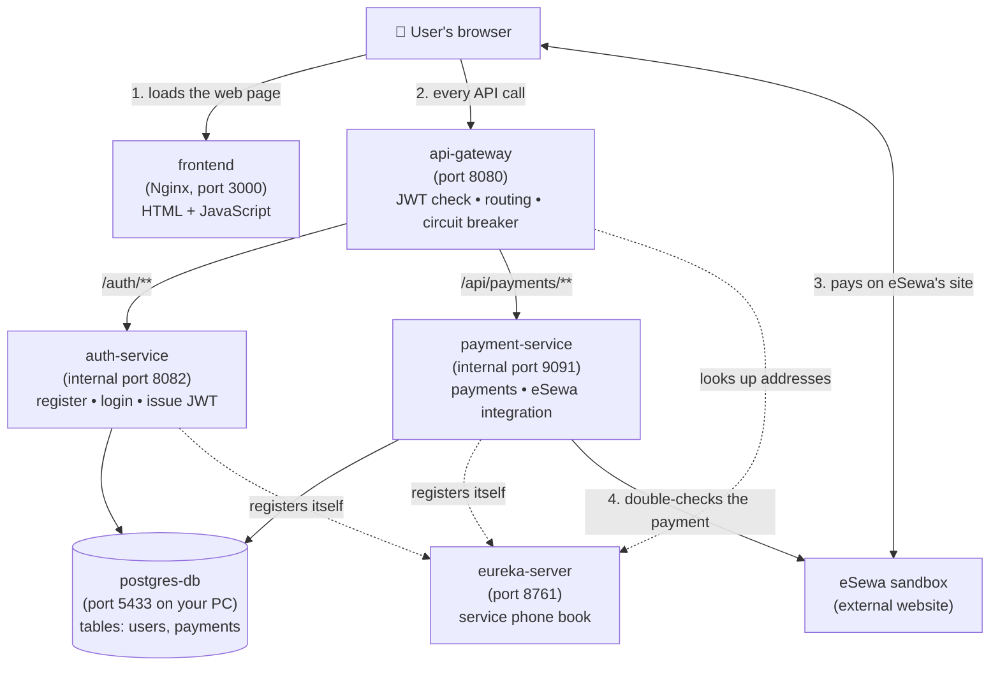
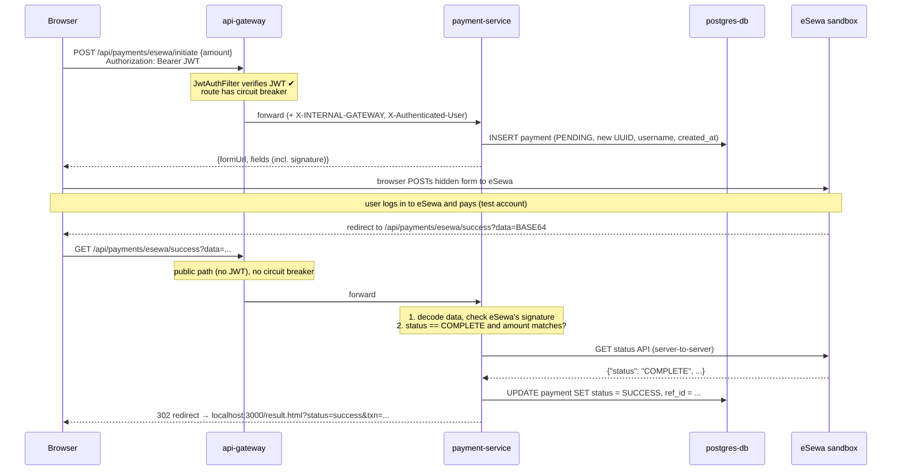

# Ripple PayGate: The Complete Project Guide

This guide is for anyone new to the project, including junior developers and interns.
You don't need to know microservices, Spring Cloud or payment gateways before you start.
Read it top to bottom once. After that, use the table of contents to jump to what you need.

> **How to read this guide:** each section starts with the idea in plain words, then shows
> where that idea lives in the code. File paths look like `payment-service/src/.../EsewaController.java`
> and you can open them in IntelliJ with *Navigate → File* (Ctrl+Shift+N).

---

## Table of contents

1. [What is Ripple PayGate?](#1-what-is-ripple-paygate)
2. [Words you need to know](#2-words-you-need-to-know)
3. [The big picture](#3-the-big-picture)
4. [The six services, one by one](#4-the-six-services-one-by-one)
5. [Walkthrough: what happens when a user pays](#5-walkthrough-what-happens-when-a-user-pays)
6. [Security: who is allowed to do what](#6-security-who-is-allowed-to-do-what)
7. [The database](#7-the-database)
8. [Configuration and secrets](#8-configuration-and-secrets)
9. [Running the project on your machine](#9-running-the-project-on-your-machine)
10. [Trying it out](#10-trying-it-out)
11. [Tests](#11-tests)
12. [Where everything lives (repository map)](#12-where-everything-lives-repository-map)
13. [How to make common changes](#13-how-to-make-common-changes)
14. [Troubleshooting](#14-troubleshooting)
15. [Known limitations and ideas for improvement](#15-known-limitations-and-ideas-for-improvement)
16. [Why it's built this way (design decisions)](#16-why-its-built-this-way-design-decisions)
17. [Quick reference](#17-quick-reference)

---

## 1. What is Ripple PayGate?

Ripple PayGate is a small **payment gateway**. A user opens a web page, creates an account,
logs in, types an amount and pays with **eSewa** (a popular digital wallet in Nepal).
Our system records the payment, checks with eSewa that the money really moved, and shows
the user whether it worked.

It uses eSewa's **sandbox**, a practice environment with fake money. **No real money ever moves.**

The project is built as **microservices**: instead of one big application, it is split
into several small programs that each do one job and talk to each other over HTTP.
This is how many real payment companies build their systems, so it is a good project to
learn from.

**Tech stack in one line:** Java 21, Spring Boot 4, Spring Cloud 2025.1 (Gateway + Eureka),
Resilience4j, PostgreSQL + Flyway, Docker, and a plain HTML/JavaScript frontend served by Nginx.

---

## 2. Words you need to know

Don't try to memorise these. Come back here whenever a word is unclear.

| Word | What it means here |
|---|---|
| **Microservice** | A small, separately running program that does one job (for example, "log users in"). Our system has four Java microservices. |
| **Container / Docker** | A container is a sealed box that holds a program plus everything it needs to run. Docker runs these boxes. Each of our services runs in its own container. |
| **Docker Compose** | A tool that starts many containers together from one file (`docker-compose.yml`). One command starts the whole system. |
| **API** | A set of URLs that a program answers. For example, `POST /auth/login` is part of auth-service's API. |
| **Endpoint** | One URL + HTTP method in an API, like `POST /api/payments/esewa/initiate`. |
| **HTTP status code** | The number a server sends back to say how the request went: `200` OK, `302` "go to this other URL", `400` bad input, `401` not logged in, `403` forbidden, `503` service unavailable. |
| **API Gateway** | The single front door. Every request from the browser goes to the gateway first, and the gateway forwards it to the right service. |
| **Service discovery / Eureka** | A "phone book" for services. Each service writes its name and address into Eureka when it starts. The gateway looks up `payment-service` in Eureka instead of having its address hard-coded. |
| **JWT (JSON Web Token)** | A login pass. After you log in, auth-service gives you a long string (the token). You send it with each request to prove who you are. It is signed, so nobody can forge or edit it without the secret key. |
| **Bearer token** | The usual way to send a JWT: an HTTP header `Authorization: Bearer <token>`. |
| **BCrypt** | A one-way scrambling (hashing) method for passwords. We store the scrambled version, never the real password. |
| **HMAC-SHA256 signature** | A short code calculated from a message and a secret key. If anyone changes the message, the code no longer matches. We use it to sign data we send to eSewa and to check data eSewa sends back. |
| **Circuit breaker** | A safety switch. If payment-service keeps failing or is very slow, the gateway stops sending it traffic for a while and answers with a friendly error immediately instead of making users wait. |
| **Merchant** | A business that accepts payments. In eSewa's terms, Ripple PayGate is the merchant. |
| **Sandbox / UAT** | A test version of eSewa with fake accounts and fake money. |
| **Callback / redirect** | After paying on eSewa's website, eSewa sends the user's browser back to a URL on our side. That return trip is the callback. |
| **JPA / Hibernate** | Java libraries that turn Java classes (like `Payment`) into database tables and rows, so we rarely write SQL by hand. |
| **Entity** | A Java class that maps to a database table (`@Entity`). |
| **Repository** | A Java interface that reads and writes one kind of entity (`PaymentRepository`). Spring writes the implementation for us. |
| **Lombok** | A library that writes boring code (getters, setters, constructors) for us through annotations like `@Getter`. |
| **Migration / Flyway** | A numbered SQL file (`V1__...sql`, `V2__...sql`) that changes the database schema. Flyway runs each one exactly once, in order, and records it, so every database ends up with the same tables. |
| **BigDecimal** | Java's exact decimal number type. Used for money because `double` can't store values like 0.1 exactly. |

---

## 3. The big picture



Key ideas:

- **The browser only ever talks to two of our things:** the frontend (to load the page) and the gateway (for every API call).
  It never calls auth-service or payment-service directly.
- **The gateway is the security guard.** It checks the JWT, then forwards the request.
- **Services find each other through Eureka**, by name. The gateway's config says `lb://payment-service`, which means
  "ask Eureka where payment-service is and send it there" (`lb` = load balancer).
- **One PostgreSQL server, two tables.** auth-service owns `users`, payment-service owns `payments`.
  Neither service touches the other's table.
- **eSewa is outside our system.** The user's browser visits eSewa's website to pay. Afterwards, payment-service
  calls eSewa's API directly to confirm the payment.

### Ports at a glance

| Service | Port on your PC | Open it in a browser? |
|---|---|---|
| frontend | `3000` | Yes: http://localhost:3000 |
| api-gateway | `8080` | API only; health at http://localhost:8080/actuator/health |
| eureka-server | `8761` | Yes: dashboard at http://localhost:8761 |
| auth-service | none (8082 inside Docker only) | No. Not published, so only the gateway can reach it |
| payment-service | none (9091 inside Docker only) | No. Not published, so only the gateway can reach it |
| postgres-db | `5433` (inside Docker it is `5432`) | Use pgAdmin, IntelliJ Database tool, or `psql` |

> **Why aren't auth-service and payment-service published?** If they were, anyone could call them directly and
> skip the gateway's login check. Inside Docker's private network the gateway still reaches them on 8082 and 9091.
>
> **Why 5433 and not 5432?** Port 5432 is PostgreSQL's default and may already be used by a Postgres installed on your PC.
> Docker maps the container's 5432 to **5433** on your machine to avoid that clash. Inside Docker, services still use
> `postgres-db:5432`.

---

## 4. The six services, one by one

### 4.1 eureka-server: the phone book

**Job:** keep a live list of which services are running and where.

- Code: `eureka-server/src/main/java/.../EurekaServerApplication.java`. It is just one class with `@EnableEurekaServer`.
  Spring Cloud does all the work.
- Config: `eureka-server/src/main/resources/application.yml`. `register-with-eureka: false` because the phone book
  doesn't need to list itself.
- Every other Java service has this in its config, which tells it where to register:
  ```yaml
  eureka:
    client:
      service-url:
        defaultZone: http://eureka-server:8761/eureka/
  ```
- Each service sends a heartbeat every 30 seconds. If heartbeats stop, Eureka eventually removes it.
- Open http://localhost:8761 to see who is registered. You should see `API-GATEWAY`, `AUTH-SERVICE` and
  `PAYMENT-SERVICE`.

### 4.2 api-gateway: the front door and security guard

**Job:** receive every API request, check the login token, send the request to the right service, and protect users
from a failing payment-service.

Built with **Spring Cloud Gateway**, which is *reactive* (non-blocking, using `Mono`/`Flux`). That's why its code
looks a little different from the other services.

| File | What it does |
|---|---|
| `api-gateway/src/main/resources/application.yml` | Routes, CORS, circuit breaker settings, under `spring.cloud.gateway.server.webflux` (the Spring Cloud Gateway 5 location). **Most gateway behaviour is configured here, not in Java.** |
| `JwtAuthFilter.java` | Runs on every request. Removes any `X-Authenticated-User` header the client sent, lets public paths through, and for everything else requires a valid JWT, then adds `X-Authenticated-User: <username from the token>` for the services behind it. |
| `FallbackController.java` | The friendly `503` (`"code": "CIRCUIT_OPEN"`) response. The gateway uses it whenever a call to payment-service fails (error, timeout, service down) **and** while the circuit is open. |

**Routes** (from `application.yml`, checked top to bottom, first match wins):

| Route id | Matches | Sent to | Circuit breaker? |
|---|---|---|---|
| `auth-service-route` | `/auth/**` | auth-service | No |
| `esewa-callback-route` | `/api/payments/esewa/success`, `/api/payments/esewa/failure` | payment-service | **No** (on purpose, see below) |
| `payment-service-route` | `/api/payments/**` | payment-service | Yes (`paymentCircuitBreaker`) |

The gateway also adds the header `X-INTERNAL-GATEWAY: true` to **every** request it forwards
(`default-filters` in the config). payment-service uses that header as a second check that a request came through
the gateway. The main protection is that payment-service's port isn't published at all.

**Who is the user?** After checking the JWT, the gateway tells the services behind it who is calling by adding
`X-Authenticated-User: <username>`. It first **removes** any such header the client sent itself, so nobody can
pretend to be someone else. payment-service trusts this header and uses it to link payments to users.

**CORS:** the browser page lives on `localhost:3000` but calls the API on `localhost:8080`. Browsers block that
unless the API says it's allowed. The `globalcors` block allows `http://localhost:3000` to call the gateway with
`GET`, `POST` and `OPTIONS`.

**Circuit breaker settings** (`resilience4j:` in the config), in plain words:

| Setting | Value | Meaning |
|---|---|---|
| `sliding-window-size` | 10 | Judge health by the last 10 calls. |
| `minimum-number-of-calls` | 5 | Don't judge until at least 5 calls happened. |
| `failure-rate-threshold` | 50 | If 50% or more failed → open the circuit. |
| `slow-call-duration-threshold` / `slow-call-rate-threshold` | 3s / 50 | A call over 3s counts as slow; if 50% or more are slow → open. |
| `wait-duration-in-open-state` | 10s | Stay open (reject immediately) for 10s. |
| `permitted-number-of-calls-in-half-open-state` | 3 | Then let 3 trial calls through. If they succeed, close the circuit again. |
| `timelimiter.timeout-duration` | 10s | Give up on a single call after 10s. |

**Circuit states:** `CLOSED` (normal, traffic flows) → `OPEN` (blocked, instant fallback) → `HALF_OPEN` (testing) →
back to `CLOSED`. You can see the current state at http://localhost:8080/actuator/health.

**Why the eSewa callback route has no circuit breaker:** when eSewa sends a user back, payment-service calls eSewa's
status API, which can take 1–3 seconds. Those slow calls could trip the breaker, and an open breaker would show
a user who just paid a JSON error while their payment stayed `PENDING`. So callbacks skip the breaker, and
payment-service protects itself with its own timeouts instead (3s to connect, 5s to read).

### 4.3 auth-service: accounts and login

**Job:** create accounts, check passwords, and hand out JWTs.

Classic Spring layered structure (you'll see this pattern in most Spring projects):

```
controller  →  service  →  repository  →  database
(HTTP in/out)  (rules)     (SQL for us)
```

| File | What it does |
|---|---|
| `controller/AuthController.java` | `POST /auth/register` and `POST /auth/login`. On success both return the JWT as **plain text** (not JSON). `@Valid` makes Spring check the request body first. |
| `controller/ApiExceptionHandler.java` | Turns errors into clear JSON: `{"error": "USERNAME_TAKEN", "message": "That username is already taken."}`. See the table below. |
| `dto/RegisterRequest.java`, `dto/AuthRequest.java` | The JSON body shape: `{ "username": "...", "password": "..." }`, plus validation rules. DTO = Data Transfer Object. |
| `service/AuthService.java` | Register: reject duplicate usernames, BCrypt-hash the password, save with role `ROLE_USER`, return a token. Login: find the user, compare the password with the stored hash, return a token. |
| `service/UsernameTakenException.java`, `service/InvalidCredentialsException.java` | The two "expected" failures, mapped to 409 and 401. |
| `service/JwtService.java` | Builds and signs tokens. A token contains the username (`sub`), issue time, and expiry (24 hours). Refuses to start if `JWT_SECRET` is missing or shorter than 32 characters. |
| `entity/User.java` | The `users` table. |
| `repository/UserRepository.java` | `findByUsername(...)`. Spring turns the method name into SQL. |
| `config/SecurityConfig.java` | Spring Security setup: `/auth/register`, `/auth/login` and Spring's `/error` page are public; no sessions (stateless); defines the BCrypt `PasswordEncoder`. |
| `src/main/resources/db/migration/` | Flyway migrations for the `users` table. |

**Validation rules and error responses:**

| Situation | Status | `error` code |
|---|---|---|
| Register: username not 3–50 chars of letters, digits, `_` `.` `-`; or password not 8–72 chars | `400` | `VALIDATION_FAILED` (the `message` lists every problem) |
| Login: username or password missing | `400` | `VALIDATION_FAILED` |
| Body isn't valid JSON | `400` | `MALFORMED_REQUEST` |
| Register: username already exists | `409` | `USERNAME_TAKEN` |
| Login: unknown user **or** wrong password | `401` | `INVALID_CREDENTIALS` |

Login gives the **same** answer for "no such user" and "wrong password" on purpose. Different answers would let an
attacker find out which usernames exist. Passwords are capped at 72 characters because BCrypt ignores anything
after the 72nd byte.

> **The shared secret:** auth-service **signs** tokens with `JWT_SECRET`. The gateway **verifies** them with the
> **same** `JWT_SECRET`. If the two don't match, every logged-in request fails with `401`.
> Both get it from the `.env` file through `docker-compose.yml`.

### 4.4 payment-service: payments and eSewa

**Job:** create payment records, talk to eSewa, and decide whether a payment succeeded.

| File | What it does |
|---|---|
| `entity/Payment.java` | The `payments` table: `id`, `transactionId`, `amount` (`BigDecimal`), `status`, `refId`, `username`, `createdAt`. |
| `repository/PaymentRepository.java` | Save/load payments; `findByTransactionId(...)`, a user's latest 20, and `findStalePending(...)` for the reconciler. |
| `security/GatewayFilter.java` | Rejects any request without the header `X-INTERNAL-GATEWAY: true` → `403 Access denied: Gateway only`. |
| `esewa/EsewaController.java` | The three eSewa endpoints: `initiate`, `success`, `failure`. **The most important file in the project.** |
| `esewa/EsewaService.java` | The eSewa "protocol": builds and signs the form, verifies eSewa's signed reply, calls eSewa's status API (`checkStatus` / `lookupStatus`). |
| `esewa/PendingPaymentReconciler.java` | Background job: every 5 minutes, re-checks payments stuck in `PENDING` for over 15 minutes with eSewa. |
| `esewa/EsewaStatus.java` | eSewa's status API answer: status + eSewa's `ref_id`. |
| `controller/PaymentHistoryController.java` | `GET /api/payments/mine`: the logged-in user's 20 most recent payments. |
| `src/main/resources/db/migration/` | Flyway migrations for the `payments` table. |
| `esewa/EsewaProperties.java` | Reads the `esewa:` block of `application.yml` into a Java record. |
| `esewa/EsewaCallback.java` | What we decoded from eSewa's reply, plus whether its signature was valid. |
| `esewa/EsewaInitiateRequest.java` / `EsewaInitiateResponse.java` | JSON in/out for `initiate`. |

**Payment status lifecycle:**

```mermaid
stateDiagram-v2
    [*] --> PENDING: initiate (user clicks Pay)
    PENDING --> SUCCESS: eSewa signature OK + amount matches + eSewa status API says COMPLETE
    PENDING --> FAILED: eSewa says the payment did not complete,\nor user cancels (failure URL)
    PENDING --> PENDING: eSewa unreachable / still processing / unclear,\n(user can revisit the link; the reconciler re-checks later)
    SUCCESS --> [*]
    FAILED --> [*]
```

Once a payment is `SUCCESS` or `FAILED`, it never changes again. Refreshing the result page just shows the same
answer.

**Stuck payments get settled automatically.** A payment can stay `PENDING` if the user closes eSewa's page, eSewa never
redirects back, or eSewa was slow to confirm. `PendingPaymentReconciler` runs every 5 minutes. For each payment that
has been `PENDING` for over 15 minutes, it asks eSewa's status API and applies the same rules as the success callback
(see the table in [section 5.2](#52-paying-with-esewa-step-by-step)). An uncertain answer leaves it `PENDING` for
the next run. Settings: `payments.reconcile.*` in payment-service's `application.yml`.

### 4.5 frontend: what the user sees

Plain HTML, CSS and JavaScript (no framework), served by Nginx.

| File | What it does |
|---|---|
| `index.html` | Three "cards" (screens): login, register, payment. Only one is visible at a time. |
| `script.js` | Calls the gateway for register/login (showing the server's error message), keeps the JWT in a variable, starts the eSewa payment, and loads "My recent payments". |
| `result.html` + `result.js` | The page eSewa's flow ends on. Reads `?status=success|pending|failed&txn=...` from the URL and shows a message. |
| `style.css` | Styling. |
| `Dockerfile` | Copies these files into an Nginx image. |

Notes:
- The JWT is kept **only in a JavaScript variable** (`jwtToken`). Reloading or leaving the page forgets it.
  That's why the result page says *"You'll need to log in again."*
- `result.js` uses `textContent`, not `innerHTML`, so nothing in the URL can inject HTML into the page. This is a
  basic defence against XSS (cross-site scripting).

### 4.6 postgres-db: the database

The official `postgres:16` image. Data is kept in a Docker **volume** called `pgdata`, so it survives
container restarts and `docker compose down`. It is only deleted by `docker compose down -v`. It has a health
check (`pg_isready`), and auth-service and payment-service wait until it passes before starting. More in
[section 7](#7-the-database).

---

## 5. Walkthrough: what happens when a user pays

This is the most important section. Follow it with the code open.

### 5.1 Register / log in

```mermaid
sequenceDiagram
    participant B as Browser (script.js)
    participant G as api-gateway
    participant A as auth-service
    participant D as postgres-db

    B->>G: POST /auth/login {username, password}
    Note over G: JwtAuthFilter: path starts with /auth/ → public, no token needed
    G->>A: forwards request (+ X-INTERNAL-GATEWAY header)
    A->>D: SELECT user WHERE username = ?
    D-->>A: user row (with BCrypt hash)
    Note over A: passwordEncoder.matches(typed password, stored hash)
    A-->>G: 200 + JWT (plain text)
    G-->>B: 200 + JWT
    Note over B: jwtToken = token; show payment screen
```

Register works the same way, except auth-service first checks that the username is free, saves the new user with a
hashed password, and then returns a token, so the user is logged in straight away.

### 5.2 Paying with eSewa, step by step



Now the same thing in words, with the code location for each step:

**Step 1: the user clicks "Pay with eSewa".**
`frontend/script.js` sends `POST /api/payments/esewa/initiate` with `{ "amount": 100 }` and the JWT.

**Step 2: the gateway checks the token.**
`JwtAuthFilter.filter(...)`: this path is not public, so it needs `Authorization: Bearer ...`. It verifies the
signature and expiry with `JWT_SECRET`. Invalid or missing → `401`. Valid → add `X-Authenticated-User` with the
username from the token and forward to payment-service (through the circuit breaker).

**Step 3: payment-service creates a PENDING payment.**
`EsewaController.initiate(...)`: refuses requests without `X-Authenticated-User` (`401`), and amounts that are
missing, ≤ 0, have more than 2 decimal places, or are too large for the database (`400`). Otherwise it saves a
`Payment` with a fresh UUID as `transactionId`, status `PENDING`, the username and the current time.

**Step 4: payment-service builds a signed form.**
`EsewaService.buildFormFields(...)` returns the fields eSewa expects (`amount`, `total_amount`,
`transaction_uuid`, `product_code`, `success_url`, `failure_url`, …) plus a `signature`:

```
signature = Base64( HMAC-SHA256( secretKey, "total_amount=100,transaction_uuid=<uuid>,product_code=EPAYTEST" ) )
```

Amounts are written by `EsewaService.formatAmount(...)`, which drops trailing zeros: `100`, `100.0` and `100.00` all
become `"100"`, and `250.50` becomes `"250.5"`. That keeps the signed text identical whether the amount comes from
the request or is read back from the database's `NUMERIC(12,2)` column.

The **secret key never leaves the server.** The browser only gets the finished signature. eSewa recalculates it on
its side, and if anyone changed the amount in the browser, the signatures won't match and eSewa rejects the payment.

**Step 5: the browser goes to eSewa.**
`submitToEsewa(...)` in `script.js` builds a hidden HTML form and submits it. eSewa needs a real form POST, not a
`fetch` call. The user is now on eSewa's website and pays with the test account (see [section 10](#10-trying-it-out)).

**Step 6: eSewa sends the user back.**
- Paid → eSewa redirects to `success_url` with `?data=<base64 JSON>`.
- Cancelled or failed → eSewa redirects to `failure_url`. We put `?txn=<uuid>` in that URL ourselves, because
  eSewa's failure redirect doesn't reliably tell us which payment it was.

These URLs point at the **gateway** (`localhost:8080`), and the gateway lets them through **without a JWT**, because
the browser is coming back from eSewa's site and doesn't send our token. That's safe only because of step 7.

**Step 7: payment-service verifies everything (`EsewaController.success`).** In order:

1. **Decode and check eSewa's signature** (`EsewaService.parseCallback`). The data passed through the user's browser,
   so it could be faked. We rebuild the signed message from the fields eSewa listed in `signed_field_names`, sign it
   with our secret, and compare using `MessageDigest.isEqual`, a comparison that takes the same time whether or not
   the strings match, so it doesn't leak hints to attackers.
2. **Find the payment** by `transaction_uuid`. Unknown → show "failed".
3. **Already decided?** If it's already `SUCCESS`/`FAILED` (the user refreshed), just show that result again.
4. **Bad signature?** Then the data didn't come from eSewa. Change nothing, show "failed".
   (Otherwise anyone who knew a transaction id could mark it paid.)
5. **Status `COMPLETE` and the amount matches what we saved?** Amounts are compared as numbers, so eSewa's
   `"1,000.0"` equals our `1000`.
6. **Ask eSewa directly** (`EsewaService.checkStatus`): a server-to-server call to eSewa's status API. This is the
   final proof, because it doesn't pass through the browser at all.
7. **Decide:**

   | eSewa status API answer | Our payment becomes | User sees |
   |---|---|---|
   | `COMPLETE` | `SUCCESS` (+ `refId` = eSewa's transaction code) | "Payment successful" |
   | `ERROR` (couldn't reach eSewa / timeout / odd reply), `PENDING`, `AMBIGUOUS` | stays `PENDING` | "Payment not confirmed yet — please don't pay again" |
   | anything else (`NOT_FOUND`, `CANCELED`, …) or the amount didn't match | `FAILED` | "Payment failed" |

   **Why keep uncertain payments `PENDING` instead of `FAILED`?** If eSewa is just slow, the user may really have
   paid. Marking it failed would invite them to pay twice. Visiting the same success link later re-checks with eSewa.

**Step 8: redirect to the result page.**
`toResultPage(...)` answers `302 Found` with
`Location: http://localhost:3000/result.html?status=success&txn=<uuid>`, and `result.js` shows the message.

---

## 6. Security: who is allowed to do what

Security in this project comes in layers. Each layer stops a different kind of problem.

| Layer | Where | Protects against |
|---|---|---|
| Passwords hashed with BCrypt | `AuthService`, `SecurityConfig` | A stolen database revealing passwords |
| JWT required for payment APIs | `JwtAuthFilter` (gateway) | Anonymous users creating payments |
| Client-sent `X-Authenticated-User` removed; real one set from the token | `JwtAuthFilter` (gateway) | Pretending to be another user |
| Service ports not published | `docker-compose.yml` | Bypassing the gateway by calling auth-service or payment-service directly |
| Gateway-only header (second line of defence) | gateway `default-filters` + payment-service `GatewayFilter` | Requests that somehow skip the gateway |
| Required secrets, no defaults | `application.yml` files, `JwtService`, `JwtAuthFilter` | Accidentally running with a known dev secret or password |
| Same error for unknown user and wrong password | `AuthService`, `ApiExceptionHandler` | Discovering which usernames exist |
| HMAC signature on the form we send to eSewa | `EsewaService.buildFormFields` | The user editing the amount in the browser |
| Verifying eSewa's signature on the callback | `EsewaService.parseCallback` | Fake "I paid" redirects |
| Amount check + server-to-server status check | `EsewaController.success`, `EsewaService.checkStatus` | Replayed or tampered callbacks |
| `textContent` on the result page | `result.js` | HTML/script injection via the URL |
| CORS allow-list | gateway `globalcors` | Other websites calling our API from a user's browser |

**Public endpoints (no JWT):**

| Endpoint | Why it's public |
|---|---|
| `POST /auth/register`, `POST /auth/login` | You need these to *get* a token. |
| `GET /api/payments/esewa/success` | The browser returns from eSewa without our token. Trust comes from eSewa's signature + status API. |
| `GET /api/payments/esewa/failure` | Same reason. It can only move a `PENDING` payment to `FAILED`. |

The list lives in `JwtAuthFilter.isPublicPath(...)`. Paths are matched **exactly**, so
`/api/payments/esewa/initiate` still needs a token.

See [section 15](#15-known-limitations-and-ideas-for-improvement) for security gaps you should know about.

---

## 7. The database

One PostgreSQL 16 server, database `paygate_db`. Tables are created and changed by **Flyway migrations**,
numbered SQL files that run once each, in order, when a service starts:

| Service | Migration folder | History table |
|---|---|---|
| auth-service | `auth-service/src/main/resources/db/migration/` | `flyway_auth_history` |
| payment-service | `payment-service/src/main/resources/db/migration/` | `flyway_payment_history` |

Each service keeps its own history table because both share one database. Hibernate no longer changes the schema;
it only **validates** (`ddl-auto: validate`) that the Java entities match the tables, and the service refuses to
start if they don't.

> **Golden rule:** never edit a migration that has already run anywhere. To change the schema, add a new file with
> the next number, e.g. `V3__add_currency.sql`. Flyway notices edited files (by checksum) and stops the service.

### `users` (owned by auth-service)

| Column | Type | Notes |
|---|---|---|
| `id` | bigint, auto-increment | Primary key |
| `username` | varchar, **unique**, not null | |
| `password` | varchar, not null | BCrypt hash like `$2a$10$...`, never the real password |
| `role` | varchar, not null | Always `ROLE_USER` for now |

### `payments` (owned by payment-service)

| Column | Type | Notes |
|---|---|---|
| `id` | bigint, auto-increment | Primary key |
| `transaction_id` | varchar, **unique** | Our UUID; eSewa calls it `transaction_uuid` |
| `amount` | numeric(12,2) | Exact money, up to 9,999,999,999.99 |
| `status` | varchar | `PENDING`, `SUCCESS` or `FAILED` |
| `ref_id` | varchar | eSewa's transaction code, filled in on success |
| `username` | varchar, indexed | Who paid. Empty for payments made before this column existed |
| `created_at` | timestamptz | When the payment was started. Empty for old payments |

> Java field `transactionId` becomes column `transaction_id`: Hibernate converts camelCase to snake_case.

### Looking at the data

From a terminal:

```bash
docker exec -it postgres-db psql -U postgres -d paygate_db \
  -c "select transaction_id, amount, status, ref_id from payments order by id desc limit 5;"
```

Or with a GUI (IntelliJ's Database tool window or pgAdmin): host `localhost`, port **`5433`**,
database `paygate_db`, user and password from your `.env`.

---

## 8. Configuration and secrets

### The `.env` file

Secrets live in a `.env` file in the project root. **It is in `.gitignore` and must never be committed.**
Docker Compose reads it and passes the values to the services as environment variables.

```env
DB_NAME=paygate_db
DB_USERNAME=postgres
DB_PASSWORD=your_password_here
JWT_SECRET=your_jwt_secret_at_least_32_characters_long
```

| Variable | Used by | Notes |
|---|---|---|
| `DB_NAME`, `DB_USERNAME`, `DB_PASSWORD` | postgres-db, auth-service, payment-service | Postgres creates the DB/user from these on **first** start only. |
| `JWT_SECRET` | auth-service (signs), api-gateway (verifies) | At least 32 characters (HMAC-SHA256 needs a 256-bit key). Must be identical in both. |

**All of these are required.** There are no fallback values for `DB_PASSWORD` or `JWT_SECRET`: if one is missing,
the service stops at startup with an error that names it. That's deliberate. Silently running with a well-known
default secret is worse than not starting.

### How config reaches the code

In each service's `application.yml` you'll see things like:

```yaml
password: ${DB_PASSWORD:changeme}
```

This means: *use the environment variable `DB_PASSWORD`; if it isn't set, use `changeme`.* The real
config for secrets uses `${DB_PASSWORD}` with no default, which means *this must be set*.

### eSewa settings (payment-service)

All under `esewa:` in `payment-service/src/main/resources/application.yml`. They default to eSewa's **public**
sandbox merchant `EPAYTEST`, and each can be overridden with an environment variable:

| Setting | Env var | Default |
|---|---|---|
| product-code | `ESEWA_PRODUCT_CODE` | `EPAYTEST` |
| secret-key | `ESEWA_SECRET_KEY` | eSewa's published sandbox key |
| form-url | `ESEWA_FORM_URL` | `https://rc-epay.esewa.com.np/api/epay/main/v2/form` |
| status-url | `ESEWA_STATUS_URL` | `https://rc.esewa.com.np/api/epay/transaction/status/` |
| success-url | `ESEWA_SUCCESS_URL` | `http://localhost:8080/api/payments/esewa/success` |
| failure-url | `ESEWA_FAILURE_URL` | `http://localhost:8080/api/payments/esewa/failure` |
| result-page-url | `ESEWA_RESULT_PAGE_URL` | `http://localhost:3000/result.html` |

Settings for the stuck-payment job (`payments.reconcile` in the same file):

| Setting | Default | Meaning |
|---|---|---|
| `enabled` | `true` | Turn the job off with `false` |
| `interval` | `PT5M` | How often it runs (ISO-8601 duration: 5 minutes) |
| `older-than` | `PT15M` | Only payments `PENDING` for longer than this (15 minutes) |

> The sandbox secret key is public (eSewa publishes it), so it's fine in the file. A **real** merchant key must
> only ever come from an environment variable or a secrets manager, never from a committed file.

### Hostnames inside Docker

Inside Docker, containers reach each other **by service name**: `postgres-db`, `eureka-server`, and so on.
That's why the configs say `jdbc:postgresql://postgres-db:5432/...` and not `localhost`.
`localhost` inside a container means "this container itself".

---

## 9. Running the project on your machine

### What you need

- **Docker Desktop**, installed and running
- **JDK 21** (the services target Java 21)
- **Git**
- Optional: **IntelliJ IDEA** (recommended), **Postman** for calling APIs

### Step by step

**1. Clone and add your `.env`**

```bash
git clone https://github.com/susir11/ripple-paygate.git
cd ripple-paygate
# create .env as shown in section 8
```

**2. Build and start everything**

```bash
docker compose up -d --build
```

`--build` builds every image; `-d` runs the containers in the background. You **don't** need Maven on your machine
for this. Each Dockerfile has two stages: the first compiles the service with Maven inside Docker, the second copies
only the finished jar into a small Java runtime image. The first build downloads all dependencies and takes a few
minutes; later builds reuse Docker's cache and are much faster.

Startup order is handled for you: Postgres and Eureka have **health checks**, and auth-service and payment-service
only start once both report healthy.

**3. Wait about one minute**

Java services take 20–40 seconds to start, and then the gateway needs up to ~60 seconds more to learn their
addresses from Eureka. Until then you may get `503 Service Unavailable` from the gateway. That's normal; wait and
retry. See [section 14](#14-troubleshooting).

**4. Check it's healthy**

```bash
docker ps                                   # all 6 containers "Up"
curl http://localhost:8080/actuator/health  # {"status":"UP",...}
```

and open http://localhost:8761. `API-GATEWAY`, `AUTH-SERVICE` and `PAYMENT-SERVICE` should be listed.

**5. Open the app:** http://localhost:3000

### Everyday Docker commands

| Task | Command |
|---|---|
| See what's running | `docker ps -a` |
| Follow a service's logs | `docker logs -f payment-service` |
| Last 100 log lines | `docker logs --tail 100 payment-service` |
| Rebuild + restart one service after a code change | `docker compose up -d --build payment-service` |
| Stop everything (keeps data) | `docker compose down` |
| Stop and **delete the database** | `docker compose down -v` ⚠️ |
| Start again after a reboot | `docker compose up -d` |

> Containers have `restart: unless-stopped`. If Docker Desktop is shut down, the containers stop and stay
> stopped until you run `docker compose up -d` again. Their logs will show a normal "graceful shutdown",
> not a crash.

### Opening it in IntelliJ

- Open the `ripple-paygate` folder. IntelliJ detects the four Maven projects.
- **File → Project Structure → Project → SDK** must be a JDK 21 that actually exists on your machine.
  If it points to a deleted JDK, IntelliJ shows red errors everywhere, even on `String`.
- After changing the SDK, open the **Maven** tool window and click **Reload All Maven Projects**.
- Lombok: make sure the Lombok plugin is enabled and **Settings → Build → Compiler → Annotation Processors →
  Enable annotation processing** is ticked.

---

## 10. Trying it out

### In the browser

1. Open http://localhost:3000 → **Register here** → pick any username/password.
2. Enter an amount (e.g. `100`) → **Pay with eSewa**.
3. On eSewa's sandbox page, use the test account:

   | | |
   |---|---|
   | eSewa ID | `9711111111` (also `9711111112`, `9711111113`) |
   | Password | `Nepal@123` |
   | MPIN | `1122` |
   | Token (OTP) | `123456` |

4. You land on `result.html` with "Payment successful", and the row in `payments` is `SUCCESS` with a `ref_id`.
5. Log in again: the payment shows up under **My recent payments**.

### With curl (or Postman)

```bash
G=http://localhost:8080

# 1. register (returns the JWT as plain text)
curl -X POST $G/auth/register -H "Content-Type: application/json" \
     -d '{"username":"intern1","password":"Passw0rd!"}'

# 2. login (also returns a JWT); save it
TOKEN=$(curl -s -X POST $G/auth/login -H "Content-Type: application/json" \
     -d '{"username":"intern1","password":"Passw0rd!"}')

# 3. start an eSewa payment → JSON with formUrl + signed fields
curl -X POST $G/api/payments/esewa/initiate \
     -H "Authorization: Bearer $TOKEN" -H "Content-Type: application/json" \
     -d '{"amount":100}'

# 4. your payments, newest first
curl $G/api/payments/mine -H "Authorization: Bearer $TOKEN"

# 5. without a token → 401
curl -i -X POST $G/api/payments/esewa/initiate -H "Content-Type: application/json" -d '{"amount":100}'

# 6. a clear error: username too short / password too short → 400 VALIDATION_FAILED
curl -X POST $G/auth/register -H "Content-Type: application/json" -d '{"username":"ab","password":"short"}'

# 7. payment-service directly → connection refused (its port isn't published)
curl -i http://localhost:9091/api/payments/mine
```

### Seeing the circuit breaker work

```bash
docker stop payment-service
# call initiate (with a token) a few times → each call returns the fallback:
# 503 {"code":"CIRCUIT_OPEN", "message":"Payment service is temporarily unavailable..."}
# after 5+ failed calls the breaker itself opens:
curl http://localhost:8080/actuator/health     # paymentCircuitBreaker state: OPEN
docker start payment-service                   # recovers after ~10s + a few successful calls
```

> The fallback message says `CIRCUIT_OPEN` even for the first few failures, before the breaker has actually opened.
> The `/actuator/health` output tells you the real state.

---

## 11. Tests

Run a service's tests from its folder (needs JDK 21; no Docker needed, because the startup tests use an in-memory
H2 database):

```bash
cd payment-service && ./mvnw test
```

| Test class | What it checks |
|---|---|
| `payment-service/.../esewa/EsewaServiceTest` | Our HMAC-SHA256 signature matches `openssl`'s output; the form signs the right fields; callback signatures are verified using eSewa's raw text (e.g. `"1,000.0"`); tampered or garbage data is rejected without crashing. |
| `payment-service/.../esewa/EsewaServiceStatusTest` | The status API call against a mock server: `COMPLETE` and `NOT_FOUND` come through; server errors and unexpected bodies become `ERROR`. |
| `payment-service/.../esewa/EsewaControllerTest` | The whole decision table in [section 5.2](#52-paying-with-esewa-step-by-step): success, failure, pending, wrong amount, bad signature, refresh after a decision. |
| `payment-service/.../esewa/EsewaWiringTest` | Spring can actually create `EsewaService` (catches config mistakes). |
| `payment-service/.../esewa/PendingPaymentReconcilerTest` | The stuck-payment job: only old payments, same decision rules, one bad row doesn't stop the rest. |
| `payment-service/.../controller/PaymentHistoryControllerTest` | `/mine` returns only the caller's payments and hides internal fields. |
| `payment-service/.../PaymentServiceApplicationTests` | The whole app starts on **H2**: Flyway runs the real migrations, Hibernate validates the entities against them. |
| `auth-service/.../AuthControllerTest` | Validation messages, 409 for a taken username, the same 401 for unknown user and wrong password. |
| `auth-service/.../AuthServiceTest` | Passwords are stored hashed; duplicate usernames (including a simultaneous sign-up race) are rejected. |
| `auth-service/.../AuthServiceApplicationTests` | The whole app starts on H2 with its Flyway migration. |
| `api-gateway/.../JwtAuthFilterTest` | Public vs protected paths; a valid token forwards the username; a client can't fake `X-Authenticated-User`; bad tokens get 401; a weak secret stops startup. |
| `api-gateway/.../ApiGatewayApplicationTests` | The gateway starts and loads all three routes from `application.yml`. |
| `eureka-server/.../EurekaServerApplicationTests` | Basic "does the app start" check. |

**Rule of thumb:** when you change payment logic, add or update a test in `EsewaControllerTest` first, watch it fail,
then change the code until it passes.

---

## 12. Where everything lives (repository map)

```
ripple-paygate/
├── docker-compose.yml          ← starts all 6 containers; wires .env values into services
├── .env                        ← YOUR secrets (not in git)
├── README.md                   ← short overview
├── docs/
│   └── PROJECT_GUIDE.md        ← this file
├── frontend/                   ← HTML/CSS/JS + Nginx Dockerfile
│   ├── index.html, script.js   ← login / register / pay
│   └── result.html, result.js  ← payment result page
├── eureka-server/              ← service registry (1 Java class)
├── api-gateway/
│   └── src/main/
│       ├── java/.../JwtAuthFilter.java, FallbackController.java
│       └── resources/application.yml   ← routes, CORS, circuit breaker
├── auth-service/
│   └── src/main/
│       ├── java/.../auth/  controller/  service/  repository/  entity/  dto/  config/
│       └── resources/db/migration/     ← Flyway SQL for the users table
└── payment-service/
    └── src/main/
        ├── java/.../payment/
        │   ├── esewa/        ← EsewaController, EsewaService, PendingPaymentReconciler, records
        │   ├── entity/       ← Payment
        │   ├── repository/   ← PaymentRepository
        │   ├── security/     ← GatewayFilter
        │   └── controller/   ← PaymentHistoryController (GET /api/payments/mine)
        └── resources/db/migration/     ← Flyway SQL for the payments table
```

Every Java service has the same Maven layout: `pom.xml` (dependencies), `mvnw` (Maven wrapper, so you don't need
Maven installed), `src/main/java` (code), `src/main/resources/application.yml` (config), `src/test/java` (tests),
`Dockerfile` (two-stage build) and `.dockerignore` (keeps `target/` and IDE files out of the build).
All four Java services use the same versions: Spring Boot 4.0.7 and Spring Cloud 2025.1.2.

---

## 13. How to make common changes

### Add a new endpoint to payment-service

1. Add a method to a controller (or create a new `@RestController`) under `/api/payments/...`.
2. It's automatically routed and protected: the gateway's `payment-service-route` matches `/api/payments/**`,
   requires a JWT and uses the circuit breaker.
3. To know who is calling, read the header the gateway sets:
   `@RequestHeader(value = "X-Authenticated-User", required = false) String username` (return `401` if it's missing).
4. Only if it must be public (rare!), add the exact path to `JwtAuthFilter.isPublicPath` and add a test for it.
5. `docker compose up -d --build payment-service`, then try it through `localhost:8080`.

### Add a brand-new microservice

1. Create a Spring Boot project with the **Eureka client** dependency; set `spring.application.name` and
   `eureka.client.service-url.defaultZone: http://eureka-server:8761/eureka/`.
2. Copy a `Dockerfile` and `.dockerignore` from another service, and add a block in `docker-compose.yml`
   (with no `ports:` unless it really must be reachable from outside Docker).
3. Add a route in `api-gateway/src/main/resources/application.yml` using `uri: lb://<your-service-name>`.
4. Decide whether it should also reject non-gateway traffic (copy `GatewayFilter`).

### Add a field to a payment

1. Add a migration: `payment-service/src/main/resources/db/migration/V3__add_<name>.sql` with
   `ALTER TABLE payments ADD COLUMN ...;`
2. Add the matching field to `Payment.java`. If the field and column don't match, the service won't start
   (`ddl-auto: validate`), which is what you want: you find out immediately.
3. Set it where payments are created/updated (`EsewaController`).
4. Run `./mvnw test`. The startup test runs all migrations on H2 and validates the entity.

### Switch from sandbox to a real eSewa merchant

Set the `ESEWA_*` environment variables (real product code, real secret key, production URLs, your public
success/failure/result URLs) in `docker-compose.yml` via `.env`. **Never** put the real secret in a committed file.

---

## 14. Troubleshooting

| Symptom | Likely cause | Fix |
|---|---|---|
| `503 Service Unavailable` from the gateway right after startup; gateway logs say `No servers available for service: auth-service` | The gateway hasn't refreshed its Eureka copy yet (refresh every 30s + a 35s cache). | Wait ~1 minute and retry. Check http://localhost:8761 shows the service. |
| `503` with `"code":"CIRCUIT_OPEN"` | A call to payment-service failed or timed out, or the breaker is open after repeated failures. | Check `docker logs payment-service`; fix the cause. The breaker retries after 10s. |
| `401 Unauthorized` on payment calls | Missing/expired token, or `JWT_SECRET` differs between auth-service and gateway. | Log in again; make sure both use the same `.env` value and were restarted after changing it. |
| `Connection refused` on port 8082 or 9091 | Those ports are no longer published (on purpose). | Call them through the gateway: `http://localhost:8080/...`. |
| My code change isn't showing up | The container wasn't rebuilt. | `docker compose up -d --build <service>` (the `--build` matters). |
| A service keeps restarting / exits | Startup error. | `docker logs <service>` and look for `APPLICATION FAILED TO START` / `Caused by:`. |
| Log says `JWT_SECRET must be set and at least 32 characters long` | `JWT_SECRET` is missing from `.env` or too short. | Set it (32+ characters), then `docker compose up -d`. |
| Log mentions `DB_PASSWORD` / `Could not resolve placeholder` | A required variable is missing from `.env`. | Add it to `.env` (see section 8). |
| Log says `Schema-validation: missing column` | An entity field has no matching column. | Add a Flyway migration for it (section 13). |
| Log says `Validate failed: Migration checksum mismatch` | A migration file that already ran was edited. | Undo the edit and put the change in a new `V<n>__` file. |
| Registration says "That username is already taken." | Someone already has that username (`409`). | Pick another one. |
| Everything is stopped after a reboot | Docker Desktop stopped the containers. | `docker compose up -d`. |
| Browser console shows a CORS error | The page isn't served from `http://localhost:3000`. | Open the app via `localhost:3000`, or add your origin to `globalcors` in the gateway config. |
| Result page says "not confirmed yet" | eSewa's status API didn't give a clear answer in time. | Payment stays `PENDING`. Revisit the same success link later; it re-checks with eSewa. Don't pay again. |
| IntelliJ: red errors on `String`, `lombok`, `jakarta` | Project SDK missing, or Maven not loaded. | Set the SDK to an installed JDK 21, then **Reload All Maven Projects**. |
| IntelliJ: `Cannot resolve table 'payments'` | IntelliJ has no database connection. | Add a data source in the Database tool window (`localhost:5433`, `paygate_db`), or ignore it. |
| Can't connect to Postgres from pgAdmin | Wrong port. | Use **5433**, not 5432. |
| A payment stays `PENDING` | The user didn't finish on eSewa, or eSewa couldn't confirm yet. | Wait: the reconciler re-checks it after 15 minutes (`docker logs payment-service \| grep Reconciled`). |
| Changed `DB_PASSWORD` in `.env` and now nothing connects | Postgres only reads it the **first** time it creates the data volume. | Change it back, or reset the DB with `docker compose down -v` (⚠️ deletes all data). |

---

## 15. Known limitations and ideas for improvement

### Fixed (2026-11-26)

The first version of this guide listed these gaps. They have all been fixed. The table says where, so you can read
how each fix works:

| Was | Now | Where |
|---|---|---|
| auth-service and payment-service ports were published, so the gateway check could be bypassed with a fake header | Ports not published; only the gateway is reachable | `docker-compose.yml` |
| `POST /api/payments/process` marked any payment `SUCCESS` | Endpoint removed | (deleted) |
| Default secrets in config (`JWT_SECRET` fallback, `changeme` password) | No defaults; services refuse to start without real values | `application.yml` files, `JwtService`, `JwtAuthFilter` |
| The gateway's `X-Authenticated-User` header was built and then thrown away | Forwarded properly; client-sent copies are removed first | `JwtAuthFilter` |
| Payments weren't linked to users | `username` stored; `GET /api/payments/mine`; shown in the frontend | `EsewaController`, `PaymentHistoryController`, `script.js` |
| Login/registration errors were generic | Clear JSON errors with 400 / 401 / 409 | `ApiExceptionHandler` |
| No input validation | Username and password rules, amount rules | `RegisterRequest`, `EsewaController` |
| Abandoned payments stayed `PENDING` forever | Re-checked with eSewa every 5 minutes | `PendingPaymentReconciler` |
| Money stored as `Double` | `BigDecimal` / `NUMERIC(12,2)` | `Payment`, migration `V2` |
| Schema managed by `ddl-auto: update` | Flyway migrations + `ddl-auto: validate` | `db/migration/` folders |
| Docker images needed jars built by hand | Multi-stage Dockerfiles build inside Docker | each `Dockerfile` |
| Mixed Spring Boot / Spring Cloud versions | All on Boot 4.0.7 / Cloud 2025.1.2 | each `pom.xml` |
| Very noisy logs (`DEBUG` web logging, every SQL statement printed) | Normal log levels | `application.yml` files |
| `depends_on` didn't wait for readiness | Health checks on Postgres and Eureka | `docker-compose.yml` |

### Still open (good first tasks)

- **The gateway-only header is a fixed value (`true`).** With the ports unpublished it can only be sent from inside
  Docker's network, which is fine locally. In production you'd use mutual TLS or a signed internal token so a
  compromised container can't impersonate the gateway.
- **The gateway takes up to a minute to find services after startup** (Eureka's 30s registry refresh plus a 35s
  load-balancer cache), so the first requests can get `503`. Shorter intervals in the gateway config would help
  for local development.
- **The callback and the reconciler could, in theory, update the same payment at the same moment.** Both only
  change `PENDING` payments, and both would reach the same answer from eSewa, so the effect is harmless. A
  `@Version` column (optimistic locking) would make it strictly safe.
- **Only Postgres and Eureka have health checks.** Adding Spring Boot Actuator to auth-service and payment-service
  would let Docker (and the gateway) know when they are truly ready.
- **There are no automated end-to-end tests** that run the whole stack in Docker. Testcontainers could do this in CI.
- **Payments made before 2026-11-26 have no `username` or `created_at`.** They don't appear under "My recent
  payments".

## 16. Why it's built this way (design decisions)

Code shows *what* the system does. This section records *why*, so you don't accidentally undo a decision that
was made on purpose. The eSewa integration was designed on 2026-11-25. Its sandbox URLs, field names and test
accounts were checked against eSewa's developer documentation that day.

### Where the eSewa code lives

| Option | Verdict | Reason |
|---|---|---|
| **Put eSewa logic inside payment-service; extend the existing plain-JS frontend** | ✅ **Chosen** | Smallest change, reuses the existing architecture, no new tools. payment-service already owns the `payments` table. |
| Same backend, new React (Vite) frontend | ❌ | Nicer UI, but adds a build step and shifts attention away from the payment flow, which is the point of the project. |
| A separate `esewa-service` microservice | ❌ | More microservice practice, but then two services would own the same payment records. More moving parts than needed. |
| Talk to eSewa directly from the browser | ❌ **Rejected outright** | Signing needs the merchant secret key. In the browser, anyone could read it and forge payments. |

### Rules the eSewa code must keep following

These come from the original design. Breaking any of them creates a security or money bug.

1. **The secret key and the signing stay on the server.** The secret must never appear in frontend code or in any
   HTTP response. (A test checks that the form fields we return don't contain it.)
2. **Never trust the success redirect on its own.** It passed through the user's browser, so it could be forged.
   We need *all three*: a valid eSewa signature, a matching amount, and `COMPLETE` from eSewa's status API.
3. **A payment only changes while it is `PENDING`.** Once `SUCCESS` or `FAILED`, it is final. This makes refreshing
   the result page, or the back button, harmless.
4. **What we sign must be exactly what we send.** All amounts go through the single function
   `EsewaService.formatAmount(...)`, so the `total_amount` text in the signature is byte-for-byte the text in the
   form. If they differ even slightly (`100` vs `100.0`), eSewa rejects the signature.
5. **Verify eSewa's reply using its raw text.** eSewa may send an amount as `"1,000.0"` or as the number `1000.0`.
   The signature check rebuilds the message from the exact text eSewa sent. Only the *amount comparison*
   strips commas and compares numbers.
6. **The failure URL carries our transaction id** (`?txn=<uuid>`), because eSewa's failure redirect doesn't reliably
   say which payment failed.

### Decisions added after the first version (from fixing real bugs)

- **Uncertain answers keep the payment `PENDING`, not `FAILED`.** Originally any non-`COMPLETE` answer marked the
  payment failed. But if eSewa was just slow or unreachable, a user who *had* paid was told it failed and might pay
  twice. Now `ERROR`, `PENDING` and `AMBIGUOUS` leave it `PENDING`, and revisiting the link re-checks.
- **A bad signature changes nothing** (it used to mark the payment `FAILED`). Otherwise anyone who learned a
  transaction id could send forged data and fail someone else's payment.
- **The gateway timeout went from 1s to 10s.** Resilience4j's default 1-second limit was shorter than eSewa's status
  API (about 1–3s), so users saw the fallback error even though their payment was recorded as `SUCCESS`.
  payment-service caps its own eSewa calls at 3s connect and 5s read, well inside 10s.
- **eSewa callbacks skip the circuit breaker** (see [section 4.2](#42-api-gateway-the-front-door-and-security-guard)).
- **payment-service builds its own HTTP client.** Spring Boot 4 doesn't automatically provide a
  `RestClient.Builder` bean with the web starter we use, so `EsewaService` creates one itself (with the timeouts
  above). `EsewaWiringTest` guards this.

### Deliberately left out

- **Going live** with a real merchant account (config is ready for it via `ESEWA_*` variables, see section 8).
- Refunds and a React/SPA frontend.

(Linking payments to users and a payment history were left out of the first eSewa version and added later, together
with the fixes in section 15.)

### Decisions from fixing the known limitations (2026-11-26)

- **Amounts are written without trailing zeros** (`formatAmount`: `100.00` → `"100"`). The database returns
  `NUMERIC(12,2)` values with two decimals, while a request may have none. Normalising keeps the signed text the same
  in both cases. eSewa's sandbox was checked to accept the new format, and to reject a tampered signature.
- **Flyway starts at "version 0" with `IF NOT EXISTS` in V1.** Both services share one database, so whichever
  starts second always sees a non-empty schema. Baselining at 0 means V1 still runs in every case; on an existing
  database it does nothing, on a new one it creates the table.
- **The reconciler only touches payments older than 15 minutes**, so it never races a user who is still on eSewa's
  page.
- **Login validation is looser than registration** (only "not blank"), so accounts created before the rules
  existed can still log in.

---

## 17. Quick reference

**URLs**

| What | URL |
|---|---|
| App | http://localhost:3000 |
| Gateway health / circuit breaker | http://localhost:8080/actuator/health |
| Eureka dashboard | http://localhost:8761 |
| Database | `localhost:5433`, database `paygate_db` |

**API (always through the gateway, `http://localhost:8080`)**

| Method | Path | Auth | Body → Response |
|---|---|---|---|
| POST | `/auth/register` | none | `{username, password}` → JWT (text); errors `400` / `409` as JSON |
| POST | `/auth/login` | none | `{username, password}` → JWT (text); errors `400` / `401` as JSON |
| POST | `/api/payments/esewa/initiate` | Bearer JWT | `{amount}` → `{formUrl, fields}` |
| GET | `/api/payments/mine` | Bearer JWT | → your 20 latest `[{transactionId, amount, status, refId, createdAt}]` |
| GET | `/api/payments/esewa/success?data=…` | none (eSewa signature) | → `302` to `result.html?status=…&txn=…` |
| GET | `/api/payments/esewa/failure?txn=…` | none | → `302` to `result.html?status=failed&txn=…` |

**The three most important files to read first**

1. `payment-service/src/main/java/com/susir/paygate/payment/esewa/EsewaController.java`: the payment flow and every decision.
2. `api-gateway/src/main/resources/application.yml`: how requests are routed and protected.
3. `api-gateway/src/main/java/com/susir/paygate/api_gateway/JwtAuthFilter.java`: how login tokens are checked.

**Further reading**

- eSewa ePay v2 docs: https://developer.esewa.com.np/pages/Epay
- Why the eSewa integration is designed the way it is: [section 16](#16-why-its-built-this-way-design-decisions)
- Spring Cloud Gateway, Netflix Eureka and Resilience4j official docs
